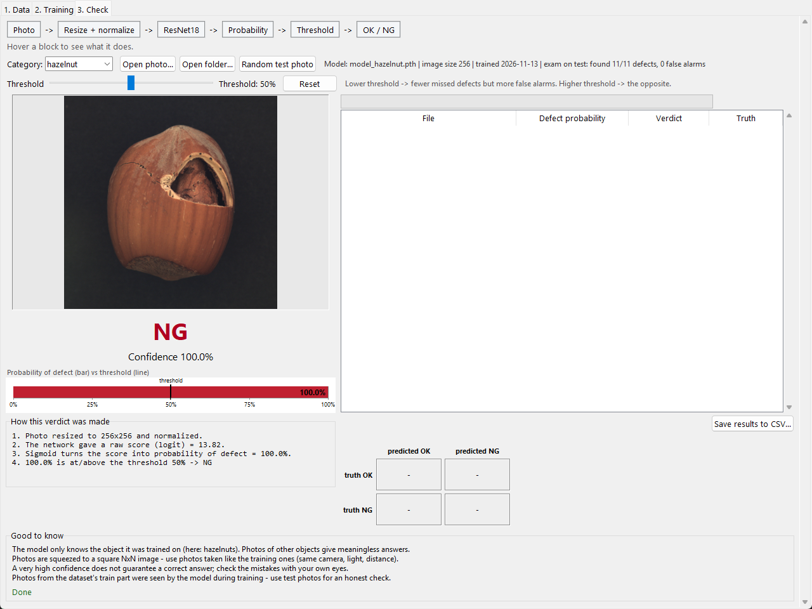
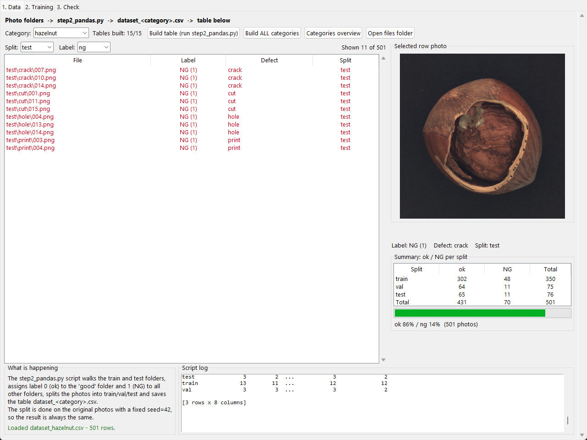
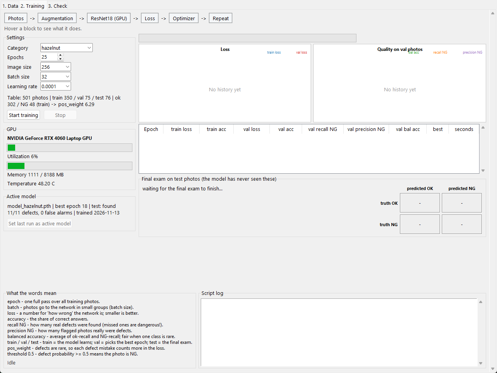

# Hazelnut Quality Control

A neural network that looks at a photo of a hazelnut and says whether it is **OK** or **NG** (defective), plus a small Windows application to prepare the data, train on the GPU and check photos.

It fine-tunes a pretrained **ResNet18** (PyTorch, CUDA) on the hazelnut category of the [MVTec AD](https://www.mvtec.com/company/research/datasets/mvtec-ad) dataset. The same code works for all 15 MVTec categories.



## Results

| Category | Test photos | Defects found | Defects missed | Good flagged as defective |
|---|---|---|---|---|
| hazelnut | 76 (11 defective) | 11 / 11 | 0 | 0 / 65 |
| wood | 49 (9 defective) | 9 / 9 | 0 | 0 / 40 |

The test photos are never used for training or for choosing the best epoch. These test sets are small and the photos are lab-quality, so the numbers show that the method works, not that it is production-ready. Details are in the [report](docs/Hazelnut_Quality_Control_Report.pdf).

## How it works

1. **Data** (`step2_pandas.py`): reads the MVTec folders, labels every photo 0 (good) or 1 (defect), and splits it 70/15/15 into train / validation / test. The split is stratified by defect type, uses a fixed seed (42), and is checked for missing files, repeated paths and duplicate content. The result is `dataset_<category>.csv`.
2. **Training** (`train.py`): ResNet18 pretrained on ImageNet, last layer replaced by one output. Photos are resized to 256x256 and augmented on the fly (flips, rotation, brightness/contrast). The loss is binary cross-entropy with `pos_weight = good / defective`, because defects are rare. The epoch with the best validation balanced accuracy is saved to `model_<category>.pth`.
3. **Check** (`check.py` or the Check tab): the network gives a raw score (logit), a sigmoid turns it into a probability of defect, and the photo is NG if the probability reaches the threshold (0.5 by default, adjustable without retraining).

## Quick start (Windows)

1. Create a virtual environment and activate it:
   ```
   python -m venv venv
   venv\Scripts\activate
   ```
2. Install PyTorch with CUDA (tested: Python 3.14, torch 2.11.0, torchvision 0.26.0, CUDA 12.8). Use only the PyTorch index; adding PyPI as an extra index can install a CPU-only build on Windows:
   ```
   pip install torch==2.11.0 torchvision==0.26.0 --index-url https://download.pytorch.org/whl/cu128
   ```
   Without an NVIDIA GPU, `pip install torch torchvision` also works but training is much slower.
3. Install the rest:
   ```
   pip install -r requirements.txt
   ```
4. Download the MVTec AD dataset from the MVTec website and unpack it. The photos are **not** included in this repository.
5. Start the app with `app.bat` (or `python app.py`). On the **Data** tab click **MVTec folder...** and select the folder that contains `hazelnut`, `wood`, ... , then click **Build ALL categories**. (Alternatively set the environment variable `MVTEC_ROOT`.)
6. On the **Training** tab choose a category and click **Start training**.

`app.bat` and `check.bat` use the `python` found on your PATH, so run them from a terminal where the virtual environment is activated. Double-clicking `app.bat` outside of it would start your system Python, which has no PyTorch. Alternatively start the app directly with `venv\Scripts\pythonw app.py`.

To skip training, download `model_hazelnut.pth` and `model_hazelnut.json` from the [Releases](../../releases) page and put them next to `app.py`. The **Check** tab then works right away.

Command line:

```
python step2_pandas.py hazelnut
python train.py hazelnut --epochs 25
python check.py --photo path\to\photo.png
```

## Files

| File | Purpose |
|---|---|
| `app.py` | Desktop application (tkinter): Data, Training, Check tabs |
| `step2_pandas.py` | Builds and validates the dataset table |
| `train.py` | Fine-tunes ResNet18 on the GPU |
| `check.py` | Classifies one photo |
| `paths.py` | Project folder and MVTec folder settings |
| `docs/` | Report (PDF) and screenshots |

## Screenshots

| Data | Training |
|---|---|
|  |  |

## Limitations

- The model only knows the object it was trained on.
- The MVTec photos were taken under controlled light and background; expect lower accuracy on a real line until the model is retrained on photos from the real camera.
- Only four defect types in the hazelnut category (crack, cut, hole, print).

## Data license and credits

- The MVTec AD dataset is licensed under **CC BY-NC-SA 4.0** (non-commercial use). It is not redistributed here. Please cite: P. Bergmann, M. Fauser, D. Sattlegger, C. Steger, *MVTec AD - A Comprehensive Real-World Dataset for Unsupervised Anomaly Detection*, CVPR 2019.
- ResNet: K. He, X. Zhang, S. Ren, J. Sun, *Deep Residual Learning for Image Recognition*, CVPR 2016.
- Code license: [MIT](LICENSE).

Author: Mykhailo Shelestiuk. Built with help from an AI coding assistant (Devin).
